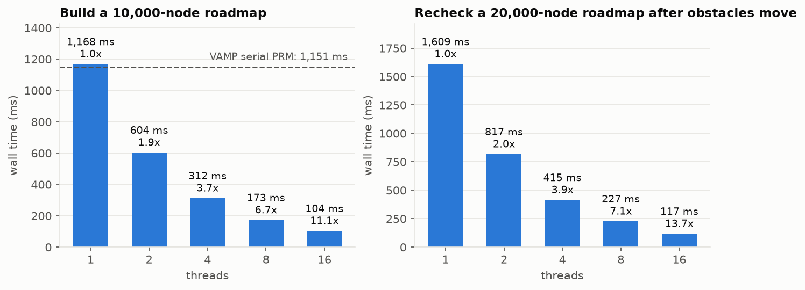

# Coven

Multi-core PRM roadmap construction and replanning built on [VAMP](https://github.com/KavrakiLab/vamp).


*Two Panda arms replan among moving obstacles on the same 5,000-node roadmap. Left: one thread.
Right: 11 threads. The faster arm stops following blocked paths sooner.*

VAMP checks one edge fast with SIMD, but its PRM checks edges one after another on a single core.
Coven checks them across all cores with OpenMP, and reuses the roadmap as obstacles move.

- **Same roadmap as VAMP.** Identical vertices, edges and sampler state to VAMP's serial PRM, for any
  thread count, batch size or schedule.
- **11× faster construction, 13–14× faster revalidation** on 16 cores.
- **Replanning on a fixed roadmap.** Recheck every vertex and edge after the obstacles move, then
  search what is still valid.
- **Header-only C++17 and Python.** Bindings for every VAMP robot, using VAMP's own Python types.
  VAMP itself is unmodified and pinned by commit.

## Quick start

Requires Linux or WSL2 with an AVX2 CPU, GCC 11+ or Clang, CMake 3.16+ and Python 3.10+.

```bash
git clone https://github.com/stevel419/coven.git && cd coven

# C++: header-only library, tests and benchmark
cmake -S . -B build -DCMAKE_BUILD_TYPE=Release
cmake --build build -j
ctest --test-dir build --output-on-failure

# Python: VAMP's package at the same commit, then Coven's bindings
pip install ".[demo,bench,test]"
pytest

# Demo from the GIF above, at http://localhost:8080
python demo/demo.py --nodes 5000 --obstacles 10
```

## Usage

```python
import numpy as np
import vamp
import coven

start = np.array([0.0, -0.785, 0.0, -2.356, 0.0, 1.571, 0.785], dtype=np.float32)
goal = np.array([2.35, 1.0, 0.0, -0.8, 0.0, 2.5, 0.785], dtype=np.float32)

settings = vamp.PRMSettings(vamp.PRMNeighborParams(vamp.panda.dimension(), vamp.panda.space_measure()))
settings.max_samples = 10_000
settings.max_iterations = 10_000_000

# Build once, in free space
coven.set_num_threads(8)
roadmap = coven.panda.build_roadmap(start, goal, vamp.Environment(), settings, vamp.panda.halton())
# The same roadmap as vamp.panda.roadmap(start, goal, vamp.Environment(), settings, vamp.panda.halton())

# Replan on it whenever the obstacles change
environment = vamp.Environment()
environment.add_sphere(vamp.Sphere([0.4, 0.4, 0.6], 0.2))
graph = coven.panda.graph(roadmap)
validity = coven.panda.revalidate(roadmap, graph, environment)
path = coven.panda.query(roadmap, graph, validity, start, goal, environment)  # empty if there is none
```

Configurations are `float32` numpy arrays. Roadmaps and paths are VAMP's Python types.
`coven.Replanner` wraps the last three calls for the Panda. Robots: `coven.panda`, `ur5`, `fetch`,
`baxter` and `sphere`.

## Performance

16 cores of a 2 × AMD EPYC 9254, GCC 13.2.0, Panda in VAMP's sphere cage.



Each doubling of threads cuts the wall time by 40–49%. Left: speedup over VAMP's serial PRM. Right:
speedup over one thread.


Edge validation, most of the work, scales 14×. Neighbor search, sampling and the serial insertion
scale less, and limit construction to 11×.

Setup, per-environment results, OpenMP schedules, batch sizes and how to reproduce:
[`bench/README.md`](bench/README.md).

## How it works

[`coven::PPRM`](include/coven/pprm.hh) builds the roadmap in batches: it checks a batch of samples in
parallel, checks all their candidate edges in one OpenMP loop, then inserts them in the serial
planner's order, so the roadmap matches VAMP's exactly. `revalidate()` rechecks every vertex and edge
in parallel after the obstacles move, and `query()` runs A* over what is still valid. Threads can share
the environment and neighbor tree because VAMP's collision checks and `nigh`'s `nearest()` only read
them.

## Acknowledgements

Coven is built on [VAMP](https://github.com/KavrakiLab/vamp) (Apache-2.0) by Zachary Kingston, Wil
Thomason, Clayton Ramsey and the Kavraki Lab:

> W. Thomason, Z. Kingston, and L. E. Kavraki. "Motions in Microseconds via Vectorized
> Sampling-Based Planning." *IEEE International Conference on Robotics and Automation (ICRA)*, 2024.
