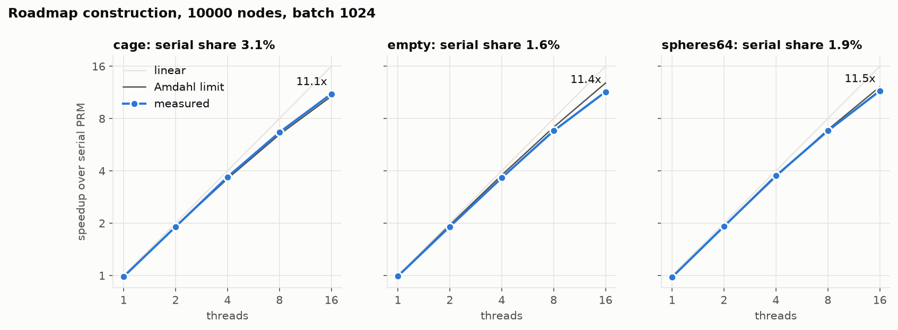
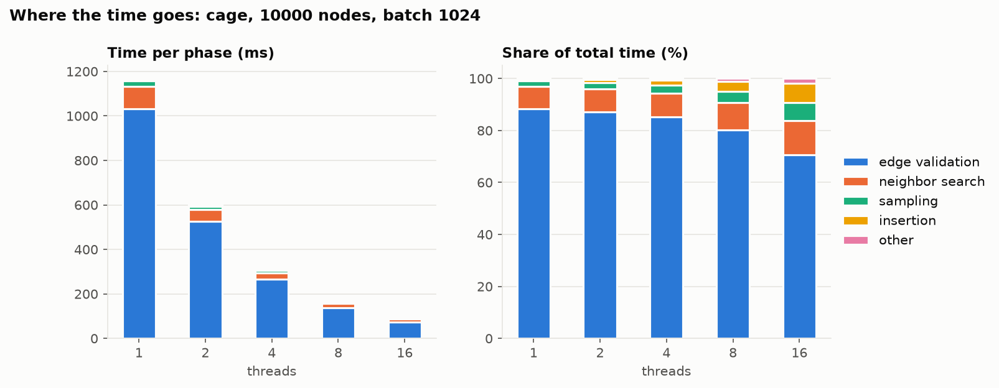
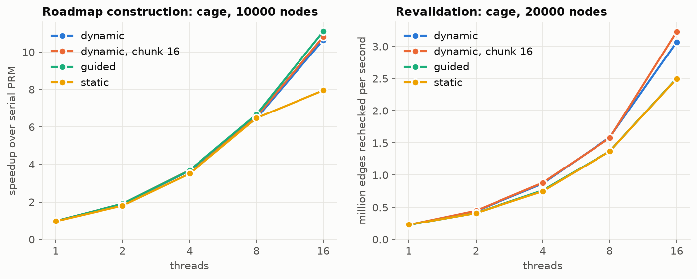
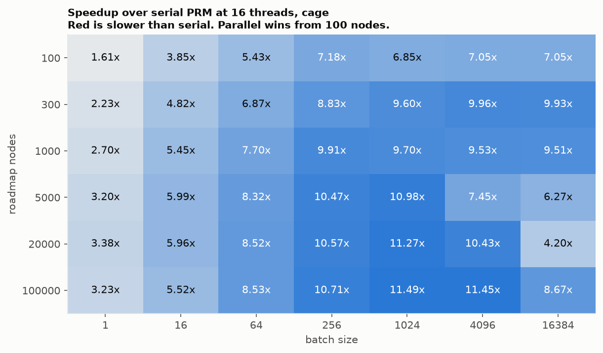
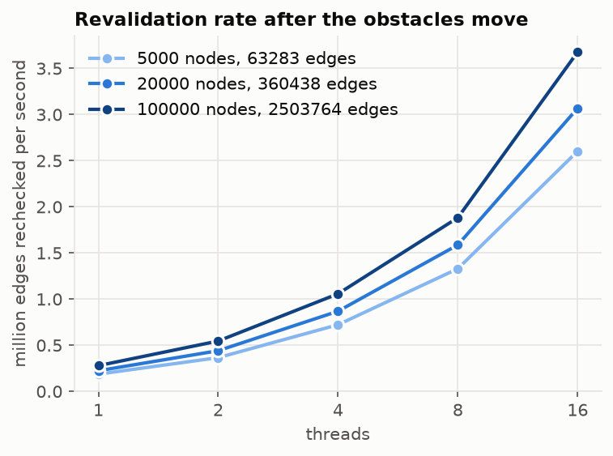

# Coven

Multi-core PRM roadmap construction and replanning for [VAMP](https://github.com/KavrakiLab/vamp).


*Two Panda arms replan among moving obstacles on the same 5,000-node roadmap. Left: one thread.
Right: 11 threads. The faster arm stops following blocked paths sooner.*

VAMP makes collision checking fast by checking eight poses along one edge at once with SIMD, on a
single core. Its PRM still checks roadmap edges one after another, and edge checking is most of the
time a PRM spends. Coven checks many edges at once across CPU cores with OpenMP. The roadmap it builds
is identical to VAMP's serial PRM: the same vertices, edges and sampler state, for any thread count.

Once built, a roadmap can be reused as obstacles move. Coven rechecks every vertex and edge against
the new environment in parallel, then searches the part that is still valid. That makes the replan
rate depend directly on the number of cores, which the demo above shows.

## How it works

`coven::PPRM::build_roadmap()` (in [`include/coven/pprm.hh`](include/coven/pprm.hh)) works through
the valid samples in batches. For each batch it:

1. draws samples in generator order, checks them in parallel, and keeps the first `B` valid ones;
2. finds each new node's neighbors among the existing roadmap nodes and the earlier nodes of the
   same batch, with `k` and `r` computed for the roadmap size the serial planner would see at that
   node;
3. checks every candidate edge of the batch in one `#pragma omp parallel for`;
4. inserts the nodes and their valid edges serially, in the serial planner's order.

Only step 3 and the sample checks run in parallel, and each edge is checked exactly as the serial
planner checks it, so the result does not depend on the batch size, thread count or OpenMP schedule.

- `revalidate()` rechecks every vertex and edge of a roadmap in parallel. A blocked vertex
  invalidates its edges without checking them.
- `query()` connects the start and goal to their nearest valid vertices and runs A* over the valid
  edges.

Two properties of VAMP make this safe:

- VAMP's generated `fkcc` collision functions only read the environment, so threads can share one
  environment. `fkcc_attach`, used when an object is attached to the gripper, writes to the
  environment, so the loops run on one thread when the environment has an attachment.
- `nigh`'s `nearest()` is `const` and keeps its search state local, so threads can query the
  neighbor tree at once as long as nobody inserts. Step 2 relies on this; step 4 is the only writer.

The collision-checking loops use the OpenMP schedules that were fastest in the benchmarks: `guided`
for construction and `dynamic` for revalidation. Define `COVEN_SCHEDULE=runtime` when compiling to
choose the schedule with `OMP_SCHEDULE` instead.

## Install

Linux or WSL2 with an AVX2 CPU, GCC 11+ or Clang, CMake 3.16+ and Python 3.10+. VAMP itself is not
modified: CMake downloads it at a pinned commit, together with its dependencies.

C++ (header-only library, tests and benchmark):

```bash
git clone https://github.com/stevel419/coven.git && cd coven
cmake -S . -B build -DCMAKE_BUILD_TYPE=Release
cmake --build build -j
ctest --test-dir build --output-on-failure
```

Python (installs VAMP's Python package from the same commit, then Coven's bindings):

```bash
pip install ".[demo,bench,test]"
pytest
```

Run `pytest` rather than `python -m pytest`: the latter puts the source folder first on the import
path, and that folder does not contain the compiled `coven._core`.

If linking fails with undefined `Catch::` or `GOMP_` symbols under a conda compiler, pass
`-DCMAKE_AR=$(which $GCC_AR) -DCMAKE_RANLIB=$(which $GCC_RANLIB)`. VAMP builds with LTO, and LTO
archives need the compiler's own `ar`.

## Usage

```python
import numpy as np
import vamp
import coven

start = np.array([0.0, -0.785, 0.0, -2.356, 0.0, 1.571, 0.785], dtype=np.float32)
goal = np.array([2.35, 1.0, 0.0, -0.8, 0.0, 2.5, 0.785], dtype=np.float32)

settings = vamp.PRMSettings(vamp.PRMNeighborParams(vamp.panda.dimension(), vamp.panda.space_measure()))
settings.max_samples = 10_000
settings.max_iterations = 10_000_000

# Build once, in free space
coven.set_num_threads(8)
roadmap = coven.panda.build_roadmap(start, goal, vamp.Environment(), settings, vamp.panda.halton())
# The same roadmap as vamp.panda.roadmap(start, goal, vamp.Environment(), settings, vamp.panda.halton())

# Replan on it whenever the obstacles change
environment = vamp.Environment()
environment.add_sphere(vamp.Sphere([0.4, 0.4, 0.6], 0.2))
graph = coven.panda.graph(roadmap)
validity = coven.panda.revalidate(roadmap, graph, environment)
path = coven.panda.query(roadmap, graph, validity, start, goal, environment)  # empty if there is none
```

Configurations are `float32` numpy arrays. The roadmap and path are VAMP's own Python types.
`coven.Replanner` wraps the last three calls for the Panda. Bindings exist for all of VAMP's robots: `coven.panda`, `ur5`, `fetch`, `baxter` and
`sphere`.

## Demo

```bash
python demo/demo.py --nodes 5000 --obstacles 10
```

Open http://localhost:8080. On first run the demo downloads VAMP's Panda model (about 9 MB).

Two Panda arms move between two poses while spheres orbit them. Each arm keeps a roadmap built once
in free space. As fast as it can, it rechecks the roadmap against the current obstacles and searches
for a path from where the arm is now. The arm follows its latest path (green) at a fixed joint
speed. Gray lines are a sample of the valid roadmap edges and red points are blocked vertices, both
drawn at the end-effector position.

- **Left arm:** replans with one thread, on a roadmap from VAMP's serial PRM.
- **Right arm:** uses Coven with the number of threads set in the panel.

Both roadmaps are identical, and the panel checks this after every build. The panel also shows:

- replans per second;
- edges checked per second;
- how often the arm is moving along a path segment that the obstacles have already blocked.

A lane that replans slowly follows older paths. You can also drag the obstacles by hand.

The arms do not dodge: an obstacle can still sweep into an arm, whatever the replan rate. The replan
rate only changes how soon an arm stops following a path that is no longer free.

## Benchmarks

`bench/bench.cc` builds `coven_bench`, which prints one CSV row per timed run: the configuration,
wall time, time per phase (sampling, neighbor search, edge validation, insertion), edges checked,
roadmap size, commit, compiler and CPU.

- **Baseline:** VAMP's unmodified `PRM::build_roadmap()`, compiled with the same compiler and flags.
- **Problem:** the Panda with the start and goal of VAMP's sphere cage example, in three
  environments: `empty`; `cage`, VAMP's 14 spheres of radius 0.2; `spheres64`, 64 spheres of
  radius 0.06 at fixed random positions.
- **Timing:** one warm-up and 20 timed runs per configuration (5 at 100,000 nodes), with the same
  sampler seed every run. Figures and tables use the median.
- **Threads:** one per physical core (`OMP_PROC_BIND=close`, `OMP_PLACES=cores`), in powers of two
  up to the number of cores available.

| Sweep | What varies | Figures |
|---|---|---|
| `scaling` | threads × environment, and threads × schedule. 10,000 nodes, batch 1024 | speedup, phase breakdown, schedule |
| `sizes` | batch size (1 to 16,384) × roadmap size (100 to 100,000), all cores | batch size |
| `revalidate` | threads × roadmap size (5,000 to 100,000), and threads × schedule at 20,000 nodes | revalidation, schedule |

```bash
cmake -S . -B build -DCMAKE_BUILD_TYPE=Release && cmake --build build -j --target coven_bench
build/coven_bench --check --mode parallel --nodes 5000 --threads 8 --repeats 0 --warmup 0
for sweep in scaling sizes revalidate; do bash bench/sweep.sh $sweep build/coven_bench bench/results/$sweep.csv; done
python bench/plot.py bench/results/*.csv --out bench/results/figures
```

`--check` fails unless the parallel roadmap equals the serial one. `REPEATS=5` in front of
`sweep.sh` shortens a sweep. `plot.py` writes the figures and `summary.txt`, the numbers behind them.

On a Slurm cluster, `bench/slurm.sh` builds on the compute node, so `-march=native` matches the CPU,
runs the check, then runs one sweep:

```bash
mkdir -p bench/results
MODULES="gcc cmake" sbatch -p <partition> --dependency=singleton bench/slurm.sh scaling
```

## Results

| | |
|---|---|
| CPU | 2 × AMD EPYC 9254 (Zen 4, 24 cores per socket, 2 hardware threads per core), shared node |
| Threads | Up to 16, one per physical core; the second hardware thread of each core is idle |
| Compiler | GCC 13.2.0, `-O3 -march=native -flto` (VAMP's Release settings) |
| Code | VAMP `27cb9b6`; Coven `e24845b` for construction, `f31279b` for revalidation (same construction code) |

Every job first checked that the parallel roadmap equals the serial one on that machine (5,000
vertices, 63,283 edges). The CSV files are in [`bench/results/`](bench/results).

### Roadmap construction



10,000 nodes, batch size 1024:

| Environment | Serial PRM | Coven, 1 thread | Coven, 16 threads | Speedup | Efficiency |
|---|---|---|---|---|---|
| `empty` | 1304.4 ms | 1317.2 ms | 114.3 ms | 11.4× | 71% |
| `cage` | 1150.7 ms | 1168.2 ms | 103.7 ms | 11.1× | 69% |
| `spheres64` | 1440.4 ms | 1473.8 ms | 124.8 ms | 11.5× | 72% |

Batching costs 1.0–2.3% on one thread. The Amdahl line treats edge validation and neighbor search as
perfectly parallel and the rest of the one-thread run (sampling, insertion and bookkeeping, 1.6–3.1%)
as serial.



| Phase (`cage`) | 1 thread | 16 threads | Scaling |
|---|---|---|---|
| Edge validation | 1032.6 ms | 73.3 ms | 14.1× |
| Neighbor search | 99.2 ms | 13.7 ms | 7.2× |
| Sampling | 26.6 ms | 7.1 ms | 3.7× |
| Insertion (serial) | 7.7 ms | 7.6 ms | — |

Edge validation drops from 88% of the time on one thread to 71% on 16. What limits the speedup is
the rest: neighbor search, sampling, the serial insertion and bookkeeping take 30 ms of the 104 ms
at 16 threads.

### OpenMP schedule



At 16 threads (in the right panel, `guided` and `static` overlap):

| Schedule | Construction, speedup over serial PRM | Revalidation, million edges per second |
|---|---|---|
| `dynamic` (chunk 1) | 10.64× | 3.07 |
| `dynamic`, chunk 16 | 10.81× | 3.23 |
| `guided` | **11.09×** | 2.50 |
| `static` | 7.95× | 2.50 |

Construction checks the edges of one batch per loop, about 26,000 at a time, and `guided` is the
fastest there. Revalidation checks every edge of the roadmap in one loop, and edge costs vary along
it: an edge with a blocked vertex is skipped, and a colliding edge stops at the first collision.
`guided` and `static` give each thread large blocks up front, so threads that draw cheap blocks wait
for the rest. `dynamic` keeps the threads balanced and is 23% faster there. Coven uses `guided` for
construction and `dynamic` for revalidation. `static` also suffers when another job on the shared
node slows one core, since it cannot rebalance. The schedule never changes the roadmap.

### Batch size



16 threads, `cage`. Coven beats the serial planner at every size measured, down to 100 nodes. The
default batch size, 1024, is the best from 5,000 nodes up and within 5% of the best below that.

- **Small batches** leave little parallel work: with batch size 1, only one node's sample and edges
  are checked at a time.
- **Large batches** slow down neighbor search. A node is compared with the earlier nodes of its own
  batch by a linear scan, which is O(B²) per batch. At 20,000 nodes, neighbor search grows from 30 ms
  at batch 1024 to 411 ms at batch 16,384.

### Revalidation



A roadmap built in `cage` is rechecked, every vertex and every edge, after every obstacle moves 5 cm
along x.

| Roadmap | Edges | 1 thread | 16 threads | Speedup | Rechecks per second |
|---|---|---|---|---|---|
| 5,000 nodes | 63,283 | 338.3 ms | 24.3 ms | 13.9× | 41 |
| 20,000 nodes | 360,438 | 1609.1 ms | 117.5 ms | 13.7× | 8.5 |
| 100,000 nodes | 2,503,764 | 8966.7 ms | 680.9 ms | 13.2× | 1.5 |

Revalidation is one parallel loop with no serial phase, so it scales better than construction. At
16 threads it checks 2.6–3.7 million edges per second.

## Layout

| Path | Contents |
|---|---|
| `include/coven/pprm.hh` | The parallel planner: header-only C++17 with OpenMP |
| `src/python.cc` | Python bindings (`coven._core`) |
| `coven/` | Python package, including `Replanner` for replanning on a fixed roadmap |
| `tests/` | C++ (Catch2) and Python tests |
| `bench/` | Benchmark driver, sweeps, plots and results |
| `demo/` | `viser` demo |

## Acknowledgements

Coven is built on [VAMP](https://github.com/KavrakiLab/vamp) (Apache-2.0) by Zachary Kingston, Wil
Thomason, Clayton Ramsey and the Kavraki Lab:

> W. Thomason, Z. Kingston, and L. E. Kavraki. "Motions in Microseconds via Vectorized
> Sampling-Based Planning." *IEEE International Conference on Robotics and Automation (ICRA)*, 2024.
