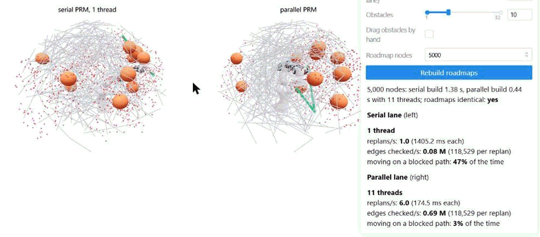

# Coven

Multi-core PRM roadmap construction and replanning for [VAMP](https://github.com/KavrakiLab/vamp).



*Two Panda arms replan among moving obstacles on the same 5,000-node roadmap. Left: one thread.
Right: 11 threads. The faster arm stops following blocked paths sooner.*

VAMP makes collision checking fast by checking eight poses along one edge at once with SIMD, on a
single core. Its PRM still checks roadmap edges one after another, and edge checking is most of the
time a PRM spends. Coven checks many edges at once across CPU cores with OpenMP. The roadmap it builds
is identical to VAMP's serial PRM: the same vertices, edges and sampler state, for any thread count.

Once built, a roadmap can be reused as obstacles move. Coven rechecks every vertex and edge against
the new environment in parallel, then searches the part that is still valid. That makes the replan
rate depend directly on the number of cores, which the demo above shows.

## How it works

`coven::PPRM::build_roadmap()` (in [`include/coven/pprm.hh`](include/coven/pprm.hh)) works through
the valid samples in batches. For each batch it:

1. draws samples in generator order, checks them in parallel, and keeps the first `B` valid ones;
2. finds each new node's neighbors among the existing roadmap nodes and the earlier nodes of the
   same batch, with `k` and `r` computed for the roadmap size the serial planner would see at that
   node;
3. checks every candidate edge of the batch in one `#pragma omp parallel for`;
4. inserts the nodes and their valid edges serially, in the serial planner's order.

Only step 3 and the sample checks run in parallel, and each edge is checked exactly as the serial
planner checks it, so the result does not depend on the batch size, thread count or OpenMP schedule.

- `revalidate()` rechecks every vertex and edge of a roadmap in parallel. A blocked vertex
  invalidates its edges without checking them.
- `query()` connects the start and goal to their nearest valid vertices and runs A* over the valid
  edges.

Two properties of VAMP make this safe:

- VAMP's generated `fkcc` collision functions only read the environment, so threads can share one
  environment. `fkcc_attach`, used when an object is attached to the gripper, writes to the
  environment, so the loops run on one thread when the environment has an attachment.
- `nigh`'s `nearest()` is `const` and keeps its search state local, so threads can query the
  neighbor tree at once as long as nobody inserts. Step 2 relies on this; step 4 is the only writer.

## Install

Linux or WSL2 with an AVX2 CPU, GCC 11+ or Clang, CMake 3.16+ and Python 3.10+. VAMP itself is not
modified: CMake downloads it at a pinned commit, together with its dependencies.

C++ (header-only library, tests and benchmark):

```bash
git clone https://github.com/stevel419/coven.git && cd coven
cmake -S . -B build -DCMAKE_BUILD_TYPE=Release
cmake --build build -j
ctest --test-dir build --output-on-failure
```

Python (installs VAMP's Python package from the same commit, then Coven's bindings):

```bash
pip install ".[demo,bench,test]"
pytest
```

Run `pytest` rather than `python -m pytest`: the latter puts the source folder first on the import
path, and that folder does not contain the compiled `coven._core`.

If linking fails with undefined `Catch::` or `GOMP_` symbols under a conda compiler, pass
`-DCMAKE_AR=$(which $GCC_AR) -DCMAKE_RANLIB=$(which $GCC_RANLIB)`. VAMP builds with LTO, and LTO
archives need the compiler's own `ar`.

## Usage

```python
import numpy as np
import vamp
import coven

start = np.array([0.0, -0.785, 0.0, -2.356, 0.0, 1.571, 0.785], dtype=np.float32)
goal = np.array([2.35, 1.0, 0.0, -0.8, 0.0, 2.5, 0.785], dtype=np.float32)

settings = vamp.PRMSettings(vamp.PRMNeighborParams(vamp.panda.dimension(), vamp.panda.space_measure()))
settings.max_samples = 10_000
settings.max_iterations = 10_000_000

# Build once, in free space
coven.set_num_threads(8)
roadmap = coven.panda.build_roadmap(start, goal, vamp.Environment(), settings, vamp.panda.halton())
# The same roadmap as vamp.panda.roadmap(start, goal, vamp.Environment(), settings, vamp.panda.halton())

# Replan on it whenever the obstacles change
environment = vamp.Environment()
environment.add_sphere(vamp.Sphere([0.4, 0.4, 0.6], 0.2))
graph = coven.panda.graph(roadmap)
validity = coven.panda.revalidate(roadmap, graph, environment)
path = coven.panda.query(roadmap, graph, validity, start, goal, environment)  # empty if there is none
```

Configurations are `float32` numpy arrays. The roadmap and path are VAMP's own Python types.
`coven.Replanner` wraps the last three calls for the Panda. Bindings exist for all of VAMP's robots: `coven.panda`, `ur5`, `fetch`, `baxter` and
`sphere`.

## Demo

```bash
python demo/demo.py --nodes 5000 --obstacles 10
```

Open http://localhost:8080. On first run the demo downloads VAMP's Panda model (about 9 MB).

Two Panda arms move between two poses while spheres orbit them. Each arm keeps a roadmap built once
in free space. As fast as it can, it rechecks the roadmap against the current obstacles and searches
for a path from where the arm is now. The arm follows its latest path (green) at a fixed joint
speed. Gray lines are a sample of the valid roadmap edges and red points are blocked vertices, both
drawn at the end-effector position.

- **Left arm:** replans with one thread, on a roadmap from VAMP's serial PRM.
- **Right arm:** uses Coven with the number of threads set in the panel.

Both roadmaps are identical, and the panel checks this after every build. The panel also shows:

- replans per second;
- edges checked per second;
- how often the arm is moving along a path segment that the obstacles have already blocked.

A lane that replans slowly follows older paths. You can also drag the obstacles by hand.

The arms do not dodge: an obstacle can still sweep into an arm, whatever the replan rate. The replan
rate only changes how soon an arm stops following a path that is no longer free.

## Tests

| What is checked | Where |
|---|---|
| Parallel roadmap equals VAMP's serial roadmap: vertices, sorted edge set, iteration count and final sampler state. 5 seeds, 6 batch sizes, 2 environments, and the iteration limit | `tests/test_pprm.cc` |
| Same roadmap with 1, 2, 4 and all threads, under `static`, `dynamic` and `guided` schedules | `tests/test_pprm.cc` |
| Parallel edge checks equal serial checks of the same edges | `tests/test_pprm.cc` |
| Revalidation after the obstacles move equals a serial recheck of every vertex and edge | `tests/test_pprm.cc`, `tests/test_replanner.py` |
| Every returned path passes VAMP's validator, edge by edge | `tests/test_pprm.cc`, `tests/test_replanner.py` |
| No data races in the `[race]` case under ThreadSanitizer | see below |

GCC's OpenMP runtime is not instrumented, so ThreadSanitizer reports false races with it. Use Clang
with LLVM's OpenMP runtime and its Archer tool:

```bash
cmake -S . -B build/tsan -DCMAKE_CXX_COMPILER=clang++ -DCMAKE_C_COMPILER=clang -DVAMP_LTO=OFF \
  -DCOVEN_BUILD_BENCH=OFF -DCMAKE_BUILD_TYPE=RelWithDebInfo \
  -DCMAKE_CXX_FLAGS=-fsanitize=thread -DCMAKE_EXE_LINKER_FLAGS=-fsanitize=thread
cmake --build build/tsan
TSAN_OPTIONS=ignore_noninstrumented_modules=1 OMP_TOOL_LIBRARIES=/path/to/libarcher.so \
  setarch x86_64 -R build/tsan/coven_tests "[race]"
```

`ignore_noninstrumented_modules=1` stops ThreadSanitizer from reporting the OpenMP runtime's own
locking, which Archer accounts for. `setarch -R` works around a ThreadSanitizer start-up failure on
recent kernels.

## Benchmarks

`bench/bench.cc` builds `coven_bench`. It prints one CSV row per timed run with:

- the configuration and wall time;
- the time per phase (sampling, neighbor search, edge checks, insertion);
- the number of edges checked and the roadmap size;
- the commit, compiler and CPU model.

The baseline (`--mode serial`) is VAMP's unmodified `PRM::build_roadmap()`, compiled with the same
compiler and flags. Every configuration gets one warm-up run, then `REPEATS` timed runs (default 20)
with the same sampler seed. Threads are pinned one per core (`OMP_PROC_BIND=close`,
`OMP_PLACES=cores`).

| Sweep | What varies | Figures |
|---|---|---|
| `scaling` | threads × environment (empty, cage, 64 spheres), and threads × schedule. 10,000 nodes, batch 1024 | speedup, phase breakdown, schedules |
| `sizes` | batch size (1 to 16,384) × roadmap size (100 to 100,000), all cores | batch-size heatmap |
| `revalidate` | threads × roadmap size (5,000 to 100,000) | revalidation rate |

To run a sweep on your own machine:

```bash
REPEATS=5 bash bench/sweep.sh scaling build/coven_bench bench/results/mine.csv
python bench/plot.py bench/results/mine.csv --out bench/results/mine
```

`plot.py` writes the figures and a `summary.txt` with the numbers behind them.

### On Euler

The job script follows the [course Slurm rules](https://github.com/tsung-wei-huang/repo759/blob/main/Assignments/general/slurm_usage.md):

- it uses the `instruction` partition;
- it sets a time limit;
- it asks only for the cores the program uses (`-c 16`).

Nothing runs on the login node except downloads and compilation.

```bash
# on the login node, in a clone of this repository
module load gcc cmake                      # check the names with: module avail gcc cmake
CPM_SOURCE_CACHE=$HOME/.cache/CPM cmake -S . -B build/euler    # downloads VAMP and its dependencies once
mkdir -p bench/results
sbatch bench/euler.sbatch scaling
sbatch bench/euler.sbatch sizes
sbatch bench/euler.sbatch revalidate
squeue -u $USER
```

Each job builds `coven_bench` on its compute node, so `-march=native` matches the CPU it runs on. It
checks that the parallel roadmap equals the serial one on that machine, then writes
`bench/results/euler-<sweep>-<job id>.csv`. Then:

```bash
python bench/plot.py bench/results/euler-*.csv --out bench/results/euler
```

Before submitting, check these in `bench/euler.sbatch`:

- **Module names** on the `module load` line.
- **Core count** (`-c 16`). `sinfo -p instruction -o "%n %c %m"` lists the cores per node.
- **Time limit** (30 minutes). `sizes` with the default 20 repeats is the longest sweep. If it runs
  out of time, submit it with `REPEATS=10 sbatch bench/euler.sbatch sizes`.

If Euler allocates hyperthreads rather than cores, `-c 16` may be only 8 physical cores. The job log
then says `using 8 threads at most`, and `-c 32` gets 16 cores.

## Results

Pending the Euler runs.

## Layout

| Path | Contents |
|---|---|
| `include/coven/pprm.hh` | The parallel planner: header-only C++17 with OpenMP |
| `src/python.cc` | Python bindings (`coven._core`) |
| `coven/` | Python package, including `Replanner` for replanning on a fixed roadmap |
| `tests/` | C++ (Catch2) and Python tests |
| `bench/` | Benchmark driver, sweeps, Euler job script and plots |
| `demo/` | `viser` demo |

## Acknowledgements

Coven is built on [VAMP](https://github.com/KavrakiLab/vamp) (Apache-2.0) by Zachary Kingston, Wil
Thomason, Clayton Ramsey and the Kavraki Lab:

> W. Thomason, Z. Kingston, and L. E. Kavraki. "Motions in Microseconds via Vectorized
> Sampling-Based Planning." *IEEE International Conference on Robotics and Automation (ICRA)*, 2024.
