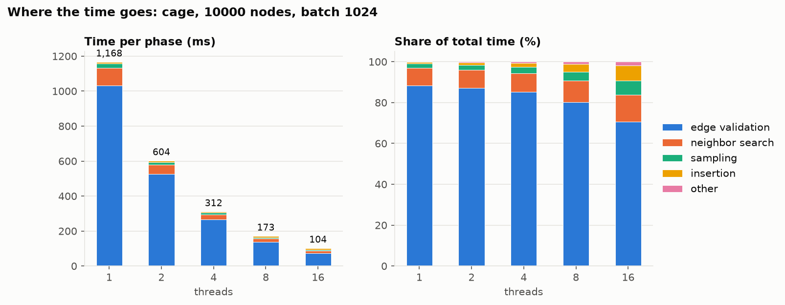
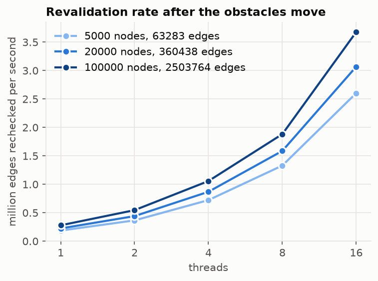
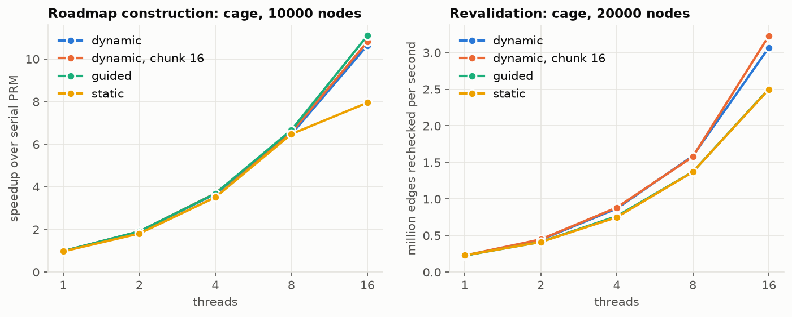
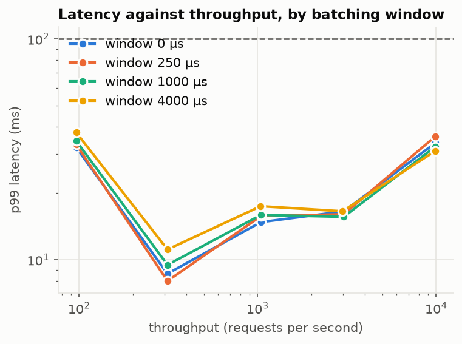
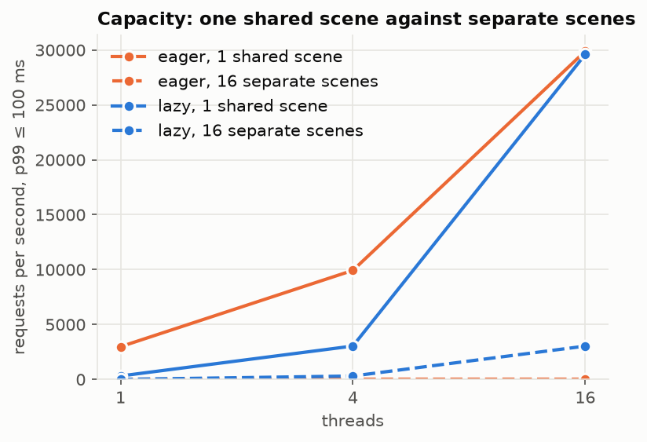
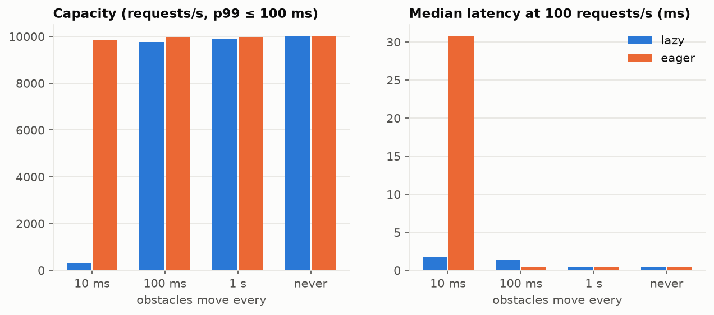
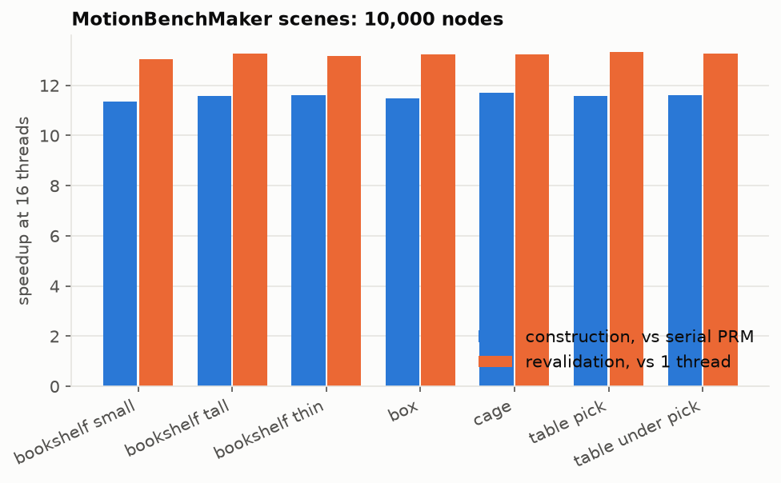
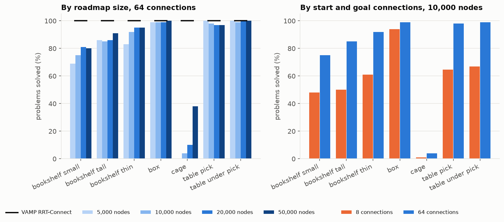
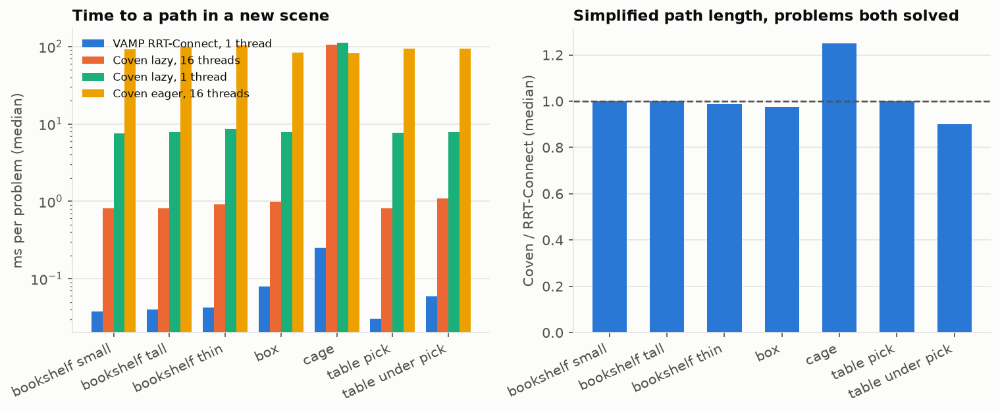

# Benchmarks

Full results behind the [Performance](../README.md#performance) section, and how to reproduce them.

## Setup

| | |
|---|---|
| CPU | 2 × AMD EPYC 9254 (Zen 4, 24 cores per socket, 2 hardware threads per core), shared node |
| Threads | Up to 16, one per physical core (`OMP_PROC_BIND=close`, `OMP_PLACES=cores`) |
| Compiler | GCC 13.2.0, `-O3 -march=native -flto` |
| Code | VAMP `27cb9b6`; Coven `e24845b` (construction) and `f31279b` (revalidation) |
| Problem | Panda, start and goal of VAMP's sphere cage example |
| Baseline | VAMP's `PRM::build_roadmap()`, same compiler and flags |
| Timing | Median of 20 runs after one warm-up (5 runs at 100,000 nodes), same sampler seed each run |

Every job first checked that the parallel roadmap equals the serial one (5,000 vertices, 63,283
edges). Raw data and the numbers behind each figure ([`summary.txt`](results/figures/summary.txt))
are in [`results/`](results).

## Construction


10,000 nodes, batch size 1024, in three environments: `empty`; `cage`, VAMP's 14 spheres of radius
0.2; `spheres64`, 64 spheres of radius 0.06.

| Environment | Serial PRM | Coven, 1 thread | Coven, 16 threads | Speedup | Efficiency |
|---|---|---|---|---|---|
| `empty` | 1304.4 ms | 1317.2 ms | 114.3 ms | 11.4× | 71% |
| `cage` | 1150.7 ms | 1168.2 ms | 103.7 ms | 11.1× | 69% |
| `spheres64` | 1440.4 ms | 1473.8 ms | 124.8 ms | 11.5× | 72% |

Batching costs 1.0–2.3% on one thread. The Amdahl line treats edge validation and neighbor search as
perfectly parallel, and the rest of the one-thread run (1.6–3.1%) as serial.



| Phase (`cage`) | 1 thread | 16 threads | Scaling |
|---|---|---|---|
| Edge validation | 1032.6 ms | 73.3 ms | 14.1× |
| Neighbor search | 99.2 ms | 13.7 ms | 7.2× |
| Sampling | 26.6 ms | 7.1 ms | 3.7× |
| Insertion (serial) | 7.7 ms | 7.6 ms | — |

Edge validation scales best. At 16 threads the other phases take 30 ms of the 104 ms and limit the
speedup.

## Revalidation



A roadmap built in `cage` is fully rechecked after every obstacle moves 5 cm along x.

| Roadmap | Edges | 1 thread | 16 threads | Speedup | Rechecks per second |
|---|---|---|---|---|---|
| 5,000 nodes | 63,283 | 338.3 ms | 24.3 ms | 13.9× | 41 |
| 20,000 nodes | 360,438 | 1609.1 ms | 117.5 ms | 13.7× | 8.5 |
| 100,000 nodes | 2,503,764 | 8966.7 ms | 680.9 ms | 13.2× | 1.5 |

Revalidation is one parallel loop with no serial phase, so it scales better than construction: 2.6–3.7
million edges per second at 16 threads.

## OpenMP schedule



At 16 threads (right panel: `guided` and `static` overlap):

| Schedule | Construction, speedup over serial PRM | Revalidation, million edges per second |
|---|---|---|
| `dynamic` (chunk 1) | 10.64× | **3.07** |
| `dynamic`, chunk 16 | 10.81× | 3.23 |
| `guided` | **11.09×** | 2.50 |
| `static` | 7.95× | 2.50 |

Coven uses the bold defaults. Construction checks about 26,000 edges per loop, where `guided` is
fastest. Revalidation checks the whole roadmap in one loop with uneven edge costs: edges at blocked
vertices are skipped, and colliding edges stop early. `dynamic` keeps threads balanced there and is
23% faster than `guided`. `static` cannot rebalance when another job slows a core. The schedule never
changes the roadmap. Compile with `COVEN_SCHEDULE=runtime` to choose it with `OMP_SCHEDULE`.

## Batch size


16 threads, `cage`. Coven beats the serial PRM at every size, down to 100 nodes. The default batch,
1024, is best from 5,000 nodes up and within 5% of the best below.

- **Small batches** leave little parallel work. Batch 1 checks one node's edges at a time.
- **Large batches** slow neighbor search: each node scans the earlier nodes of its batch, O(B²) per
  batch. At 20,000 nodes this grows from 30 ms at batch 1024 to 411 ms at batch 16,384.

## Planning service

`coven_load` ([`load.cc`](load.cc)) runs the service in process and sends it requests:

- **Roadmap:** 10,000 nodes, built in free space.
- **Scenes:** `cage`, moved along x by 0.1 sin(2π (t / 2 s + s / scenes)) for scene s; every scene moves
  every 10 ms, 100 ms or 1 s, or never (1 s unless stated).
- **Requests:** open loop, as a Poisson process at a fixed rate, between random pairs of 512
  collision-free configurations. Latency runs from each request's scheduled arrival to its answer, so
  a slow service cannot slow its own load.
- **Timing:** one second of warm-up, then 3 s measured; at most 4,096 requests in flight, more are
  refused.
- **Rates:** 100, 300, 1,000, 3,000, 10,000 and 30,000 requests per second.
- **Capacity:** the highest tested rate served with p99 latency at most 100 ms and nothing refused.
  The steps are coarse: 10,000 means "between 10,000 and 30,000", and 30,000 means "at least
  30,000".
- **Served at 30,000:** requests answered per second when 30,000 per second are offered.

[`load.py`](load.py) runs the same test over HTTP against `coven-server`. Coven `5d9553a`.

### Batching window



Lazy, one scene moving every second, 16 threads. Up to 30,000 requests per second, the highest rate
tested, the p50 stays at 0.3–4.5 ms and the p99 under 60 ms. Waiting for a batch to fill never
helps: when the service is busy, new requests join the next round anyway, and when it is idle the
wait only adds latency (p50 at 100 requests/s: 0.4 ms with no window, 4.5 ms with 4 ms). The default
window is 0.

### Threads and scenes



Scenes moving every second, capacity in requests per second:

| | 1 thread | 4 threads | 16 threads | Served at 30,000, 16 threads |
|---|---|---|---|---|
| Lazy, 1 shared scene | 313 | 3,038 | 29,598 | 29,598 |
| Lazy, 16 separate scenes | 0 | 309 | 3,031 | 15,926 |
| Eager, 1 shared scene | 2,979 | 9,930 | 29,892 | 29,892 |
| Eager, 16 separate scenes | 0 | 0 | 0 | 23,376 |

At 30,000 offered, lazy with one scene answers 1,284 requests per second on 1 thread, 9,445 on 4 and
29,598 on 16: at least 23× from 1 to 16 threads, since 16 threads keep up with the offered rate.
Separate scenes share no checks: each request in a fresh scene version finds its blocked edges on its
own, which takes 3.4–10 rounds instead of 2–3 in a shared scene. Eager with 16 scenes has p50 under
10 ms but p99 of 165–300 ms: all 16 scenes move at the same moment, and the 16 rechecks run back to
back while requests wait.

### Lazy against eager



One scene, 16 threads:

| Obstacles move | Lazy capacity | Eager capacity | Lazy p50 at 100/s | Eager p50 at 100/s |
|---|---|---|---|---|
| every 10 ms | 307 | 9,874 | 1.7 ms | 28.7 ms |
| every 100 ms | 9,990 | 29,901 | 1.2 ms | 0.4 ms |
| every second | 29,598 | 29,892 | 0.4 ms | 0.4 ms |
| never | 30,010 | 30,016 | 0.4 ms | 0.4 ms |

- **Eager** rechecks the whole roadmap on every change, about 14 ms here. Requests then need no edge
  checks, but a recheck can run before each of their two rounds: when the scene changes every 10 ms,
  the dispatcher is rechecking 89–96% of the time up to 3,000 requests per second, and the median
  request takes about 30 ms.
- **Lazy** checks only edges on candidate routes, so requests rarely wait behind anything, but the
  first requests after each change know nothing yet and take 4–5 rounds. When the scene changes
  every 10 ms, most requests are such requests, and the p99 passes 100 ms between 300 and 1,000
  requests per second. Every 100 ms, lazy serves 10,000 requests per second and eager 30,000.
- When the scene changes every second or never, both serve at least 30,000 requests per second.

At 30,000 offered with 16 threads and one scene, the dispatcher spends 51–83% of its time connecting
new requests and searching, which run in parallel across requests, and 11–17% checking.

## MotionBenchMaker

The 700 Panda problems VAMP ships ([MotionBenchMaker](https://github.com/KavrakiLab/motion_bench_maker)):
seven scenarios of 100 problems, each a scene of boxes and capsules with a start and a goal, exported
once to [`mbm_panda.txt`](mbm_panda.txt). One problem (table pick 41) has its start or goal in
collision and is skipped, as in VAMP's evaluation. Coven `59f8abb`, same machine and setup as above.

### Construction and revalidation



10,000 nodes, built in each scenario's first scene; revalidation after its obstacles move 5 cm. The
speedups hold on every scenario: construction 11.4–11.7× over VAMP's serial PRM (1.45–1.73 s serial),
revalidation 13.1–13.3× over one thread (1.35–1.57 s on one thread, 100–120 ms on 16).

### Problems solved



The service plans on one roadmap built once in free space, so a problem is solved only when the
roadmap reaches through the scene from its start to its goal. VAMP's RRT-Connect searches each problem
from scratch and solves all of them.

| Scenario | 5,000 nodes | 10,000 | 20,000 | 50,000 | 10,000, 8 connections |
|---|---|---|---|---|---|
| Bookshelf small | 69% | 75% | 81% | 80% | 48% |
| Bookshelf tall | 86% | 85% | 86% | 91% | 50% |
| Bookshelf thin | 83% | 92% | 95% | 95% | 61% |
| Box | 99% | 99% | 99% | 100% | 94% |
| Cage | 0% | 4% | 10% | 38% | 1% |
| Table pick | 100% | 98% | 97% | 97% | 65% |
| Table under pick | 100% | 99% | 100% | 100% | 67% |

- **Connections matter more than size.** MotionBenchMaker starts and goals sit in tight spots, between
  shelves or beside objects, where the nearest few roadmap vertices are often not reachable in a
  straight line. Trying 64 vertices instead of 8 adds 5–35 points at 10,000 nodes outside the cage; going from 5,000 to
  50,000 nodes adds at most 12 outside the cage. 64 is now the default.
- **The cage needs narrow passages** that a roadmap built in free space rarely covers: 4% at 10,000
  nodes, 38% at 50,000.

### Time and path length



Time to a path in a new scene, median over the problems each method solved (for Coven, the problems
its roadmap reaches, which leaves out some of the hardest):

| | Scene setup | Plan | Total |
|---|---|---|---|
| VAMP RRT-Connect, 1 thread | – | 0.03–0.08 ms (cage 0.25) | 0.03–0.08 ms |
| Coven lazy, 16 threads | 0.49–0.57 ms | 0.31–0.60 ms (cage 105) | 0.81–1.10 ms |
| Coven lazy, 1 thread | 6.7–7.8 ms | 0.66–0.83 ms | 7.6–8.6 ms |
| Coven eager, 16 threads | 76–102 ms | 0.42–0.50 ms | 82–103 ms |

- **For one query in a new scene, RRT-Connect is 12–27 times faster** than the service, outside the
  cage. About half of the service's time is the scene setup: checking all 10,000 vertices (lazy) or the whole
  roadmap (eager) before planning.
- **Once a scene is set up, a plan takes 0.3–0.6 ms**, and every further request in that scene shares
  the checks already made; that is the case the service is for (see [Planning service](#planning-service)).
- **Path length after VAMP's simplification is the same** as RRT-Connect's on the problems both solved
  (median ratio 0.90–1.00), except in the cage (1.25). Before simplification Coven's paths are shorter
  (5.9–6.7 against 6.6–10.6 in configuration space, cage aside).

## Reproduce

`coven_bench` ([`bench.cc`](bench.cc)) prints one CSV row per timed run: configuration, wall time,
time per phase, edges checked, roadmap size, commit, compiler and CPU.

| Sweep | What varies | Figures |
|---|---|---|
| `scaling` | threads × environment, threads × schedule; 10,000 nodes, batch 1024 | 0, 1, 2, 3 |
| `sizes` | batch size (1 to 16,384) × roadmap size (100 to 100,000), all cores | 4 |
| `revalidate` | threads × roadmap size (5,000 to 100,000), threads × schedule at 20,000 nodes | 0, 3, 5 |
| `service` | request rate × batching window, × threads and shared or separate scenes, × lazy or eager and how often obstacles move | 6, 7, 8 |
| `service-http` | request rate, over HTTP and in process (needs `pip install .`) | 9 |
| `mbm` | MotionBenchMaker: construction and revalidation per scenario, 10,000 nodes | 10 |
| `mbm-problems` | every MotionBenchMaker problem with VAMP's RRT-Connect and with the service, by roadmap size and start and goal connections | 11, 12 |

From the repository root:

```bash
cmake -S . -B build -DCMAKE_BUILD_TYPE=Release && cmake --build build -j --target coven_bench coven_load coven_mbm
build/coven_bench --check --mode parallel --nodes 5000 --threads 8 --repeats 0 --warmup 0
for sweep in scaling sizes revalidate service mbm mbm-problems; do bash bench/sweep.sh $sweep build/coven_bench bench/results/$sweep.csv; done
python bench/plot.py bench/results/*.csv --out bench/results/figures
```

- `--check` fails unless the parallel roadmap equals the serial one.
- `REPEATS=5 bash bench/sweep.sh ...` shortens a sweep; `DURATION=1` shortens each load test.
- `plot.py` writes the figures and `summary.txt`.

On a Slurm cluster, [`slurm.sh`](slurm.sh) builds on the compute node, runs the check, then one 
sweep:

```bash
mkdir -p bench/results
MODULES="gcc cmake" sbatch -p <partition> --dependency=singleton bench/slurm.sh scaling
```
