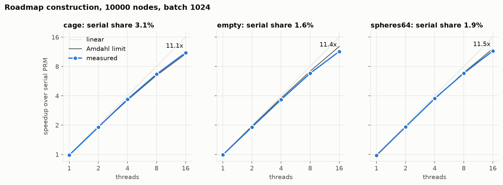
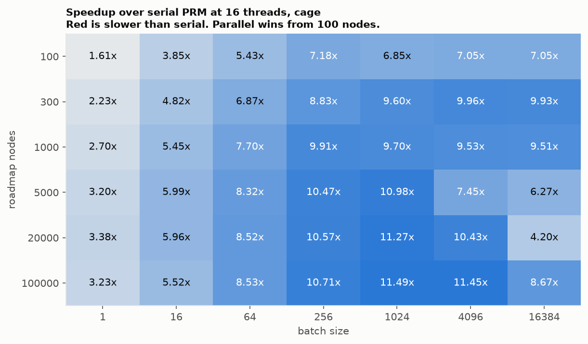

# Benchmarks

Full results behind the [Performance](../README.md#performance) section, and how to reproduce them.

## Setup

| | |
|---|---|
| CPU | 2 × AMD EPYC 9254 (Zen 4, 24 cores per socket, 2 hardware threads per core), shared node |
| Threads | Up to 16, one per physical core (`OMP_PROC_BIND=close`, `OMP_PLACES=cores`) |
| Compiler | GCC 13.2.0, `-O3 -march=native -flto` (VAMP's Release settings) |
| Code | VAMP `27cb9b6`; Coven `e24845b` (construction) and `f31279b` (revalidation) |
| Problem | Panda, start and goal of VAMP's sphere cage example |
| Baseline | VAMP's unmodified `PRM::build_roadmap()`, same compiler and flags |
| Timing | Median of 20 runs after one warm-up (5 runs at 100,000 nodes), same sampler seed each run |

Every job first checked that the parallel roadmap equals the serial one (5,000 vertices, 63,283
edges). Raw data and the numbers behind each figure ([`summary.txt`](results/figures/summary.txt))
are in [`results/`](results).

## Construction



10,000 nodes, batch size 1024, in three environments: `empty`; `cage`, VAMP's 14 spheres of radius
0.2; `spheres64`, 64 spheres of radius 0.06.

| Environment | Serial PRM | Coven, 1 thread | Coven, 16 threads | Speedup | Efficiency |
|---|---|---|---|---|---|
| `empty` | 1304.4 ms | 1317.2 ms | 114.3 ms | 11.4× | 71% |
| `cage` | 1150.7 ms | 1168.2 ms | 103.7 ms | 11.1× | 69% |
| `spheres64` | 1440.4 ms | 1473.8 ms | 124.8 ms | 11.5× | 72% |

Batching costs 1.0–2.3% on one thread. The Amdahl line treats edge validation and neighbor search as
perfectly parallel, and the rest of the one-thread run (1.6–3.1%) as serial.


| Phase (`cage`) | 1 thread | 16 threads | Scaling |
|---|---|---|---|
| Edge validation | 1032.6 ms | 73.3 ms | 14.1× |
| Neighbor search | 99.2 ms | 13.7 ms | 7.2× |
| Sampling | 26.6 ms | 7.1 ms | 3.7× |
| Insertion (serial) | 7.7 ms | 7.6 ms | — |

Edge validation scales best. At 16 threads the other phases take 30 ms of the 104 ms and limit the
speedup.

## Revalidation


A roadmap built in `cage` is fully rechecked after every obstacle moves 5 cm along x.

| Roadmap | Edges | 1 thread | 16 threads | Speedup | Rechecks per second |
|---|---|---|---|---|---|
| 5,000 nodes | 63,283 | 338.3 ms | 24.3 ms | 13.9× | 41 |
| 20,000 nodes | 360,438 | 1609.1 ms | 117.5 ms | 13.7× | 8.5 |
| 100,000 nodes | 2,503,764 | 8966.7 ms | 680.9 ms | 13.2× | 1.5 |

Revalidation is one parallel loop with no serial phase, so it scales better than construction: 2.6–3.7
million edges per second at 16 threads.

## OpenMP schedule


At 16 threads (right panel: `guided` and `static` overlap):

| Schedule | Construction, speedup over serial PRM | Revalidation, million edges per second |
|---|---|---|
| `dynamic` (chunk 1) | 10.64× | **3.07** |
| `dynamic`, chunk 16 | 10.81× | 3.23 |
| `guided` | **11.09×** | 2.50 |
| `static` | 7.95× | 2.50 |

Coven uses the bold defaults. Construction checks about 26,000 edges per loop, where `guided` is
fastest. Revalidation checks the whole roadmap in one loop with uneven edge costs: edges at blocked
vertices are skipped, and colliding edges stop early. `dynamic` keeps threads balanced there and is
23% faster than `guided`. `static` cannot rebalance when another job slows a core. The schedule never
changes the roadmap. Compile with `COVEN_SCHEDULE=runtime` to choose it with `OMP_SCHEDULE`.

## Batch size



16 threads, `cage`. Coven beats the serial PRM at every size, down to 100 nodes. The default batch,
1024, is best from 5,000 nodes up and within 5% of the best below.

- **Small batches** leave little parallel work. Batch 1 checks one node's edges at a time.
- **Large batches** slow neighbor search: each node scans the earlier nodes of its batch, O(B²) per
  batch. At 20,000 nodes this grows from 30 ms at batch 1024 to 411 ms at batch 16,384.

## Planning service

`coven_load` ([`load.cc`](load.cc)) runs the service in process and sends it requests:

- **Roadmap:** 10,000 nodes, built in free space.
- **Scenes:** `cage`, moved along x by 0.1 sin(2π (t / 2 s + s / scenes)) for scene s; every scene moves
  every 10 ms, 100 ms or 1 s, or never (1 s unless stated).
- **Requests:** open loop, as a Poisson process at a fixed rate, between random pairs of 512
  collision-free configurations. Latency runs from each request's scheduled arrival to its answer, so
  a slow service cannot slow its own load.
- **Timing:** one second of warm-up, then 3 s measured; at most 4,096 requests in flight, more are
  refused.
- **Capacity:** the highest throughput served with p99 latency at most 100 ms and nothing refused.

[`load.py`](load.py) runs the same test over HTTP against `coven-server`.

## Reproduce

`coven_bench` ([`bench.cc`](bench.cc)) prints one CSV row per timed run: configuration, wall time,
time per phase, edges checked, roadmap size, commit, compiler and CPU.

| Sweep | What varies | Figures |
|---|---|---|
| `scaling` | threads × environment, threads × schedule; 10,000 nodes, batch 1024 | 0, 1, 2, 3 |
| `sizes` | batch size (1 to 16,384) × roadmap size (100 to 100,000), all cores | 4 |
| `revalidate` | threads × roadmap size (5,000 to 100,000), threads × schedule at 20,000 nodes | 0, 3, 5 |
| `service` | request rate × batching window, × threads and shared or separate scenes, × lazy or eager and how often obstacles move | 6, 7, 8 |
| `service-http` | request rate, over HTTP and in process (needs `pip install .`) | 9 |

From the repository root:

```bash
cmake -S . -B build -DCMAKE_BUILD_TYPE=Release && cmake --build build -j --target coven_bench coven_load
build/coven_bench --check --mode parallel --nodes 5000 --threads 8 --repeats 0 --warmup 0
for sweep in scaling sizes revalidate service; do bash bench/sweep.sh $sweep build/coven_bench bench/results/$sweep.csv; done
python bench/plot.py bench/results/*.csv --out bench/results/figures
```

- `--check` fails unless the parallel roadmap equals the serial one.
- `REPEATS=5 bash bench/sweep.sh ...` shortens a sweep; `DURATION=1` shortens each load test.
- `plot.py` writes the figures and `summary.txt`.

On a Slurm cluster, [`slurm.sh`](slurm.sh) builds on the compute node, runs the check, then one 
sweep:

```bash
mkdir -p bench/results
MODULES="gcc cmake" sbatch -p <partition> --dependency=singleton bench/slurm.sh scaling
```
